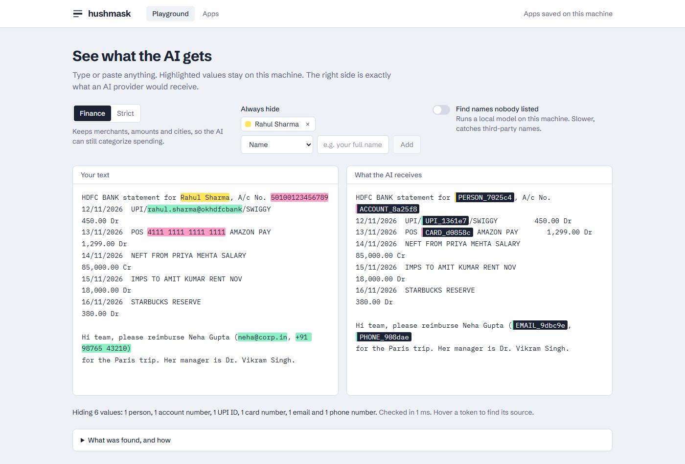

# hushmask

Hide personal data before text goes to an AI, and put the real values back after.

```
your text ──▶ detect PII ──▶ swap for tokens ──▶ AI ──▶ swap tokens back ──▶ result
                                   │                           ▲
                                   └── vault (in memory only) ─┘
```

```
Statement for Rahul Sharma            Statement for PERSON_8b2b69
UPI/rahul.sharma@okhdfcbank/SWIGGY ─▶ UPI/UPI_29353b/SWIGGY
POS 4111 1111 1111 1111 AMAZON PAY    POS CARD_3ef187 AMAZON PAY
```

Merchants, amounts and dates stay, so the AI can still do its job (categorize, summarize, extract).

> **Status: early.** Text only. Patterns, your own list, and an optional local model for names and
> addresses. See [docs/PLAN.md](docs/PLAN.md) for phases and known gaps.

## Try it

```bash
uv sync
uv run hushmask detect examples/statement.txt --known "PERSON=Rahul Sharma"
uv run hushmask mask examples/statement.txt --known "PERSON=Rahul Sharma" --vault vault.json > masked.txt
uv run hushmask restore masked.txt --vault vault.json
```

The vault file holds the real values. Delete it when you're done.

### Names nobody listed (`--ner`)

Patterns can't recognise "NEFT FROM PRIYA MEHTA". Add a local model (GLiNER, runs on CPU). It's heavy: ~700 MB of PyTorch and friends, plus a ~1 GB model
downloaded on first use, ~7 s to load and well under a second per page after that.

```bash
uv sync --extra ner
uv run hushmask mask examples/statement.txt --preset finance --known "PERSON=Rahul Sharma" --ner
```

```
14/11/2026  NEFT FROM PERSON_2939e5 SALARY           85,000.00 Cr
15/11/2026  STARBUCKS RESERVE                         380.00 Dr
```

Statements are ALL CAPS and glue words together (`NEFT-SUNITA RAO-REFUND`), which NER models handle badly.
The model reads a same-length copy with separators turned into spaces and capitals title-cased; on our samples
that took it from missing third-party names to catching all of them. Organisations are not masked: on a
statement they are merchants.

### Same person, different spellings

Shorter forms of a full name link to it: if "Rahul Sharma" is `PERSON_3c9ef6`, "Mr Sharma" becomes
`PERSON_3c9ef6_1`. The AI can tell it's the same person, and each restores to exactly what was written.
If two people share the surname, nothing is linked.

**Project page:** [`site/index.html`](site/index.html) is a single self-contained page that explains hushmask,
with a live redaction demo that runs in the browser. Open it directly, or serve it with GitHub Pages.

## Dashboard



```bash
cd web && npm install && npm run build && cd ..     # once; builds into src/hushmask/web_dist
uv run --extra proxy hushmask serve                 # add --extra ner for the names model
# open http://127.0.0.1:8700/dashboard/
```

- **Playground:** type or paste text and watch it get marked up live. Highlighter colours show what was found
  (people, numbers, contact details, places); the right side shows the redaction tape the AI would see. Hover a
  token to find its source. "Send it to an AI" runs the text through one of your apps and shows what left the
  machine, what the AI answered, and what you get back.
- **Apps:** add an app per program, pick its provider (OpenAI, Gemini, Ollama, OpenRouter, Groq or any
  OpenAI-compatible URL), its preset and its "always hide" list, and copy its base URL and key. Apps are saved
  in `~/.hushmask/apps.json`; per-app counts show how much was hidden or refused (counts only, never values).

The dashboard API only answers on `localhost` and only with an `X-Hushmask-Admin` header, so another website
open in your browser can't read your apps or create new ones (no CSRF, no DNS rebinding).

## Use it as a proxy (any OpenAI-compatible app)

The proxy pretends to be the AI. Your app sends its request to hushmask, hushmask masks it, forwards it to
the real provider, and restores the answer. In the app, the only change is the base URL.

```bash
uv sync --extra proxy            # add --extra ner for model-based names
uv run hushmask serve --upstream http://localhost:11434/v1 --preset finance --known "PERSON=Rahul Sharma" --ner
# app: base URL http://127.0.0.1:8700/v1, its usual API key (forwarded upstream)
```

A real run through a local `qwen2.5:7b`, extracting transactions with structured output:

```
upstream saw:  NEFT FROM PERSON_4aee58 SALARY 85,000.00 Cr     STARBUCKS RESERVE 380.00 Dr
app got back:  14/11/2026  Income   85000.0  PRIYA MEHTA        16/11/2026  Coffee  380.0  STARBUCKS RESERVE
```

**Several apps, each with its own rules:** run `hushmask serve` with no flags and add apps in the dashboard,
or keep them in a file: copy [`hushmask.example.toml`](hushmask.example.toml) to `hushmask.toml` and run
`hushmask serve --config hushmask.toml` (read-only in the dashboard). Each app gets its own hushmask key,
upstream, preset and known values. The real provider key stays with the proxy, never in the app.

| Start with | Apps come from | Dashboard can edit apps |
|---|---|---|
| `hushmask serve` | `~/.hushmask/apps.json` (or `--store PATH`) | yes |
| `hushmask serve --config hushmask.toml` | the TOML file | no |
| `hushmask serve --upstream URL` | one implicit app, caller's own key forwarded | no |

What it does with a request:

- Masks every message (system, user, assistant history, tool results, tool-call arguments, `name`). System and
  developer messages skip the model detector: they're instructions, and model noise breaks them.
- Adds a short system note telling the model to copy placeholders exactly (only when something was masked).
- Restores the answer, including JSON content and tool-call arguments value by value, so a quote in a real
  value can't break the JSON.
- Refuses images, audio and files (they can't be masked) unless the app sets `allow_images`.
- Calls upstream without streaming (a placeholder split across chunks can't be restored). If the client asked
  for `stream: true`, the whole answer comes back as server-sent events.
- Uses the same token secret for every request of an app, so history is masked identically each turn and the
  provider's prompt cache keeps working.
- Headers `X-Hushmask-Masked` and `X-Hushmask-Unknown-Tokens` on every answer; `GET /hushmask/stats` gives
  per-app counts (never values). Supports `POST /v1/chat/completions`, `GET /v1/models`, `GET /health`.

## How well it works

Share of personal values **fully** hidden on labelled data ([full tables](docs/eval/RESULTS.md),
[method and caveats](docs/eval/README.md)):

| Data | Patterns | + your list | + names model | Over-masking (best setup) |
|---|---:|---:|---:|---|
| Synthetic bank statements (300, finance preset) | 50.6% | 73.0% | **99.4%** | 0 spans; 0 of 1,396 merchants touched |
| ai4privacy English (500 records, strict) | 26.5% | n/a | **87.0%** | 200 ordinary words masked |
| ai4privacy German (300 records, strict) | 25.6% | n/a | **90.0%** | 106 ordinary words masked |

The synthetic statements come from the same project as the detectors and flatter them; ai4privacy is the
honest number. Most ai4privacy leaks are random-digit "card numbers" that fail the Luhn check (left alone on
purpose) and street addresses. Usernames, passwords, dates of birth and ID numbers aren't detected at all; they
are listed separately in the results, not hidden in the totals.

## Use it from Python

```python
from hushmask import EntityType, GlinerDetector, KnownValue, Masker, Policy

masker = Masker(
    policy=Policy.preset("finance"),
    known=[KnownValue("Rahul Sharma", EntityType.PERSON)],
    extra_detectors=[GlinerDetector()],  # optional, needs the 'ner' extra
)

masked = masker.mask(statement_text)  # masked.text goes to the AI
answer = call_your_llm(masked.text)
print(masker.restore(answer).text)  # real values back

data, info = masker.restore_json(parsed_json)  # structured output: restores every string
```

One `Masker` is one session: the same value always gets the same token, and the vault grows as you mask more.

## What it detects

| Type | How | Checked |
|---|---|---|
| Your own values (name, address, IDs) | `--known` list, whole words, case/space-insensitive | exact |
| Card | 13–19 digits | Luhn |
| IBAN | country + check digits | mod 97 |
| Aadhaar | 12 digits | Verhoeff |
| PAN, IFSC | format | pattern |
| Account number | next to "A/c", "Account No." | context |
| Email, UPI ID, phone, IPv4 | format | pattern |
| Names, street addresses, cities | local model (`--ner`) | confidence ≥ 0.5 |

## Safety rules

- **Fail closed.** After masking, the text is scanned again with the pattern and list detectors. If anything is
  still visible, `mask()` raises `LeakError` (which never contains the values) instead of returning text. The
  model doesn't take part in this check, so its noise can't fail requests at random.
- **Vault in memory.** Nothing is written to disk unless you ask the CLI to (`--vault`).
- **Not anonymization.** Merchants, amounts, dates and places can still identify someone in combination.
  This hides *who you are* from the AI provider; it doesn't make data anonymous.

## Development

```bash
uv run pytest
uv run ruff check . && uv run ruff format --check .

# real-model tests (slow, downloads the model)
HUSHMASK_MODEL_TESTS=1 uv run --extra ner pytest -k real
```
